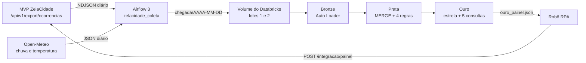

# ZelaCidade · Big Data (Global Solution FIAP 2026.2)

> Bruno Venturi Lopes Vieira · RM 99431
> Guilherme Alves de Lima · RM 550433
> Leonardo de Oliveira Ruiz · RM 98901

## Ficha técnica

| Item | Descrição |
|---|---|
| Produto | ZelaCidade: o morador registra problemas de manutenção em espaços públicos com foto e local; a IA sugere a categoria, um robô faz a triagem, a comunidade confirma e a organização responsável acompanha num painel |
| Cidadão e território | Moradores da Zona Norte de São Paulo, na área da Subprefeitura Santana/Tucuruvi: Santana, Jardim São Paulo, Mandaqui e Tucuruvi |
| Problema | Buracos, calçadas quebradas, iluminação apagada e obstáculos ficam sem registro organizado e sem prioridade clara |
| Fontes deste repo | Export diário do MVP (NDJSON, interna) e Open-Meteo (chuva e temperatura, externa e pública) |
| MVP | <https://app-zelacidade-gs-99431.azurewebsites.net> · repo <https://github.com/brunoventuri01/zelacidade> |
| ODS | 11 (metas 11.3 e 11.7) e 9 (meta 9.1) |

## O que este repo faz



| Fonte | Tipo | Formato | Frequência | Arquivo em `chegada/` |
|---|---|---|---|---|
| API do ZelaCidade (`/export/ocorrencias`) | interna, do produto | NDJSON | diária | `ocorrencias/ocorrencias_AAAA-MM-DD.json` |
| Open-Meteo (chuva e temperatura no bairro) | externa, pública, sem chave | JSON | diária | `clima/clima_AAAA-MM-DD.json` |

## Estrutura

| Caminho | Conteúdo |
|---|---|
| `docker-compose.yml` | Airflow 3.3.2 enxuto: Postgres, api-server, scheduler e dag-processor (LocalExecutor) |
| `dags/zelacidade_coleta.py` | DAG diário: `inicio >> [coletar_ocorrencias, coletar_clima] >> conferir_chegada` |
| `dags/coleta_lib.py` | Funções da coleta, sem Airflow, cobertas por testes |
| `tests/` | `pytest` das funções e da estrutura do DAG |
| `amostras/` | Exemplos do export, só com dados simulados (`simulado=true`, e-mails `@exemplo.com`) |
| `databricks/` | Notebooks Bronze, Prata, Ouro, consultas e export |
| `chegada/` | Onde o Airflow grava os arquivos do dia (fora do Git) |

## Como rodar o Airflow (Windows)

Pré-requisito: Docker Desktop com WSL 2 e pelo menos 4 GB de memória para o Docker.

1. No PowerShell, dentro da pasta do repo, crie o `.env` e troque os `CHANGE_ME`:

   ```powershell
   Copy-Item .env.example .env
   notepad .env
   ```

2. Inicialize o banco e o usuário (espere terminar com `exited with code 0`) e suba o Airflow:

   ```powershell
   docker compose up airflow-init
   docker compose up -d
   ```

3. Abra <http://localhost:8080> e entre com o usuário e a senha do `.env`.
4. Em **Admin > Variables**, cadastre as chaves, que nunca ficam no código:

   | Variable | Valor |
   |---|---|
   | `ZELA_API_URL` | `https://app-zelacidade-gs-99431.azurewebsites.net` |
   | `ZELA_API_KEY` | a `EXPORT_API_KEY` do MVP |
   | `ZELA_ALERTA_WEBHOOK` | opcional: webhook do Discord, Slack ou Teams para o alerta de falha |
   | `ZELA_LATITUDE`, `ZELA_LONGITUDE` | opcionais: centro do bairro piloto (padrão −23,4865 e −46,6210) |

5. Em **Dags**, ative o `zelacidade_coleta`. Como o DAG começa em 01/11/2026 e tem `catchup=True`, o Airflow cria uma execução para cada dia já terminado. Os arquivos aparecem em `.\chegada\ocorrencias` e `.\chegada\clima`.

Para desligar: `docker compose down`. Para apagar também o banco do Airflow: `docker compose down -v`.

Se o MVP público estiver fora do ar, rode o MVP no PC (repo `zelacidade`, `docker compose up`) e use `http://host.docker.internal:8000` como `ZELA_API_URL`.

### Requisitos atendidos pelo DAG

| Requisito | Como |
|---|---|
| 2 fontes, 1 externa | Export do MVP e Open-Meteo |
| DAG agendado gravando em `chegada/` | Todo dia à meia-noite de São Paulo, desde 01/11, com catchup; um arquivo por fonte por dia, com a data no nome; a reexecução regrava o mesmo arquivo |
| Paralelismo | `coletar_ocorrencias` e `coletar_clima` rodam ao mesmo tempo |
| Verificação | `conferir_chegada` confere se os dois arquivos existem, se cada linha tem os campos obrigatórios e se o clima é do dia certo, sem chuva negativa |
| Chaves fora do código | `ZELA_API_URL` e `ZELA_API_KEY` em Variables; `.env` fora do Git |
| Falhas | 2 novas tentativas por tarefa (1 min de espera) e alerta no log e no webhook |

Sobre o clima: o histórico ERA5 do Open-Meteo chega com cerca de 5 dias de atraso, então os dias dos últimos 90 vêm da API de previsão (`past_days`) e os mais antigos, do histórico.

## Testes

```powershell
pip install -r requirements-dev.txt
python -m pytest tests
```

Sem o Airflow instalado, os testes do DAG são pulados e rodam só os das funções da coleta.

## LGPD

- As chaves ficam em Variables e no `.env`, fora do Git.
- O export só traz o e-mail de quem deu consentimento. Na Prata ele vira `sha2(e-mail + sal)` com máscara, e a coordenada é arredondada para cerca de 100 m.
- Fotos nunca entram no lake.
- As amostras deste repo são só dados simulados.
